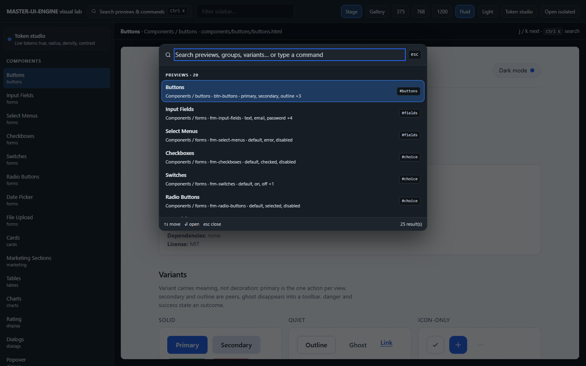
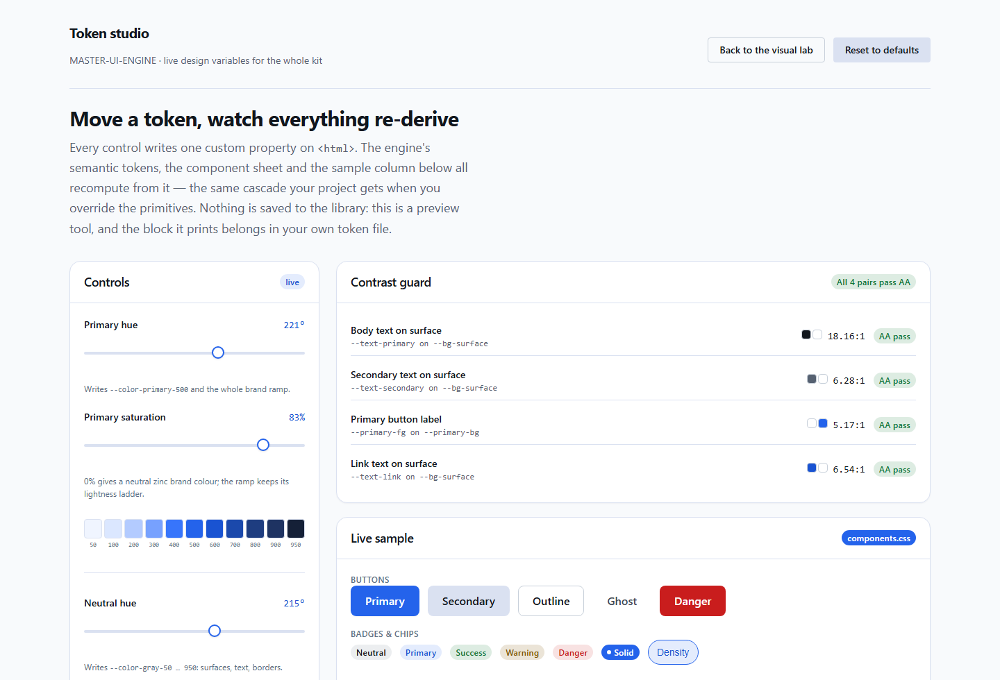
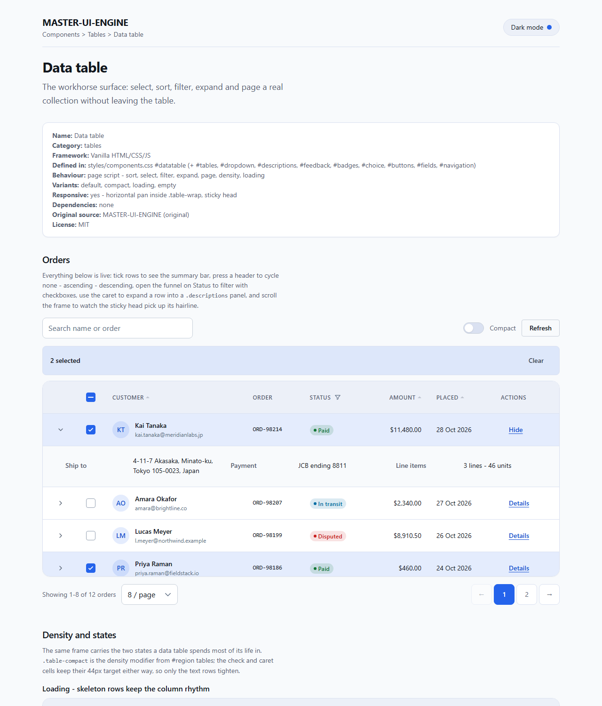
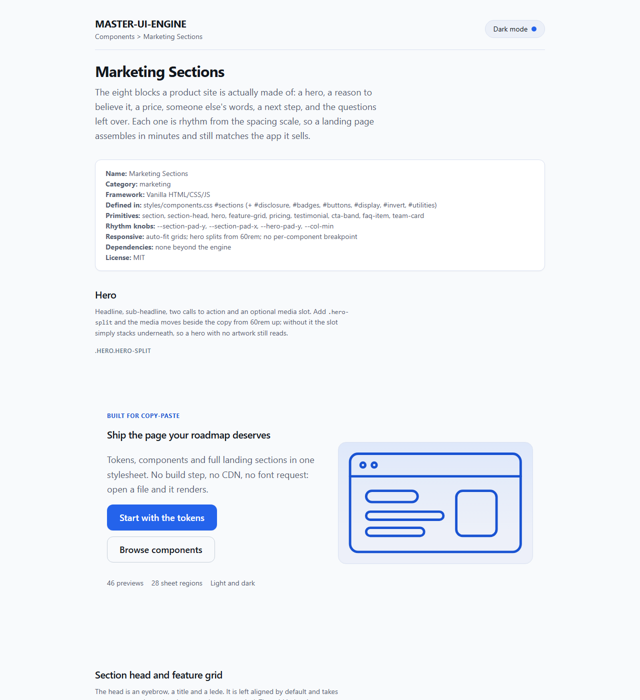
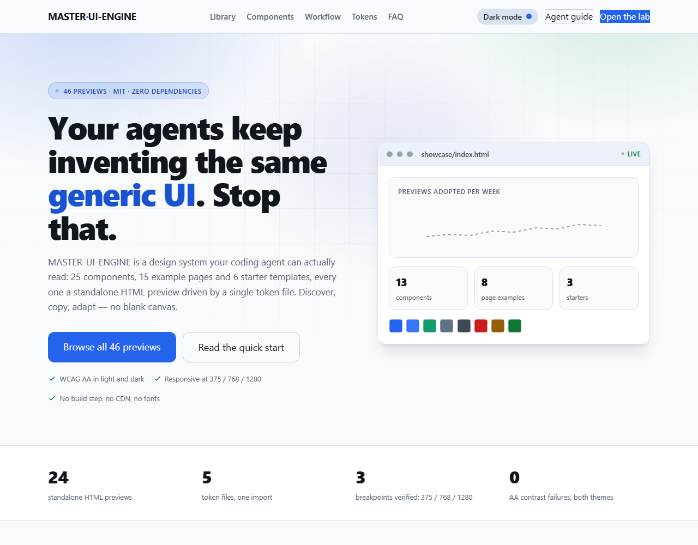
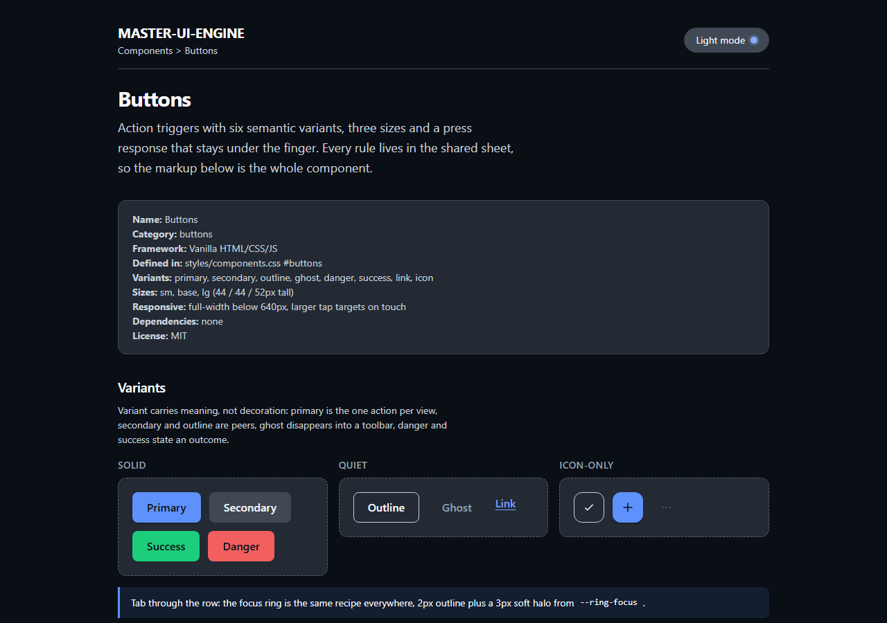

# MASTER-UI-ENGINE

A reusable UI/UX design system and component library for AI coding agents.
Stop generating generic interfaces from scratch. Explore, copy, and adapt
professionally designed components, page layouts, and application templates.

> **Visual design laboratory** — 54 previews that render in a browser with no
> build step. 41 of them (every component preview, every starter template, and
> three example pages) are built from one token file, one shared component sheet
> and one behaviour script, so a single edit restyles the whole library. The 13
> remaining `examples/` pages and the lab itself are still self-contained.
>
> **Agent API** — `node tools/mue.js search "card grid"` finds the preview,
> `show` prints its contract and markup, `region` prints exactly the CSS it
> needs. No grep, no re-invention. See [`tools/README.md`](tools/README.md).

| | |
|---|---|
|  |  |
|  |  |
|  |  |

---

## Repository contents

| Section | What it contains |
|---------|------------------|
| `design-tokens/` | The token system: primitives, semantics, type/spacing/border/shadow scales, light + dark themes, and `engine.css` (single entry point) |
| `components/` | 33 component previews — buttons, forms (inputs, selects, checkboxes, radios, switches, date picker, file upload), navigation (menu, header, breadcrumbs, tabs, pagination), cards, tables plus a full data table (select, sort, filter, expand, page), charts, dialogs, modals, dropdowns, popovers, sidebars, footers, notifications, feedback (progress, skeleton, empty state, error state, stepper), display (avatars, stats, timeline, rating, descriptions), marketing sections (hero, features, pricing, testimonials, FAQ, CTA, team), and tour + float buttons |
| `examples/` | 15 complete-page previews — dashboards, analytics, ecommerce, marketplace, chat/AI apps, login/signup, landing, portfolio, booking, education |
| `templates/` | 6 starter-application templates — SaaS, admin, analytics, ecommerce, marketplace, AI web app |
| `showcase/` | The visual lab (`index.html`), the machine-readable catalog (`data/`), and the catalog build script |
| `styles/` | `components.css` — every component class in the kit, split into `/* #region name */` blocks so a snippet can be copied with exactly the rules it needs — and `mue.js`, the shared behaviour layer (theme toggle, Copy buttons, tabs, dropdowns, dialogs, toasts, accordions, reveals) |
| `tools/` | `mue.js` — a dependency-free CLI that is the query API for this library: search previews, print one `#region` of CSS, look a class up, scaffold a page against the sheet, run the audit gate. `tools/audit/` holds the server, the browser contrast/overflow harness, and the conversion spec |
| `site/` | The product site: static marketing pages plus a searchable library and template explorer that iframe the real previews, and three Vercel functions (`/api/track`, `/api/stats`, `/api/subscribe`) backed by Supabase. `site/engine/` is generated by `node site/build.mjs` and is not committed. Deploy steps are in `DEPLOYMENT.md` |
| `supabase/schema.sql` | The three analytics tables and the waitlist table, with the grants the functions need |
| `AGENTS.md` | The agent workflow, file conventions, and quality gates |
| `CONTRIBUTING.md` | How to add a component or template |
| `RESOURCES.md` | Phase-1 research on open-source UI libraries with license and redistribution status |
| `LICENSE` | MIT for original MASTER-UI-ENGINE code |

The converted previews link the shared tokens and sheet, so a component is never
a one-off: change a token or a `#region`, change the library.

---

## Quick start

1. **Open the visual lab** — double-click `showcase/index.html`. It loads
   `showcase/data/catalog.js`, so it works straight from the filesystem. If you
   prefer a local server (needed only if you want to reload the catalog through
   HTTP tooling):

   ```powershell
   python -m http.server 4173
   # or: powershell -File showcase/serve.ps1
   ```

   Then open [http://127.0.0.1:4173/showcase/index.html](http://127.0.0.1:4173/showcase/index.html).
   The sidebar lists every design; **Gallery** shows scaled thumbnails of
   all 54; the 375 / 768 / 1200 / Fluid buttons resize the stage; **Open
   isolated** opens the raw file in its own tab. `j` / `k` step through designs.

2. **Or open any single file** — `components/buttons/buttons.html`,
   `examples/ecommerce/ecommerce-homepage.html`, and so on render standalone.

3. **Choose a visual direction** — the lab's theme selector applies Core blue,
   Editorial, Evergreen, Violet, or Monochrome to shared-token previews and
   remembers the choice in `localStorage["mue-theme-name"]`. Each preview also
   has a Light/Dark control persisted in `localStorage["mui-theme"]`.

4. **Copy the source** — every converted preview ends with a code block and two
   buttons injected by `styles/mue.js`: **Copy markup** puts the HTML on the
   clipboard, and **Copy + CSS** adds the `#region` blocks from
   `styles/components.css` that snippet actually needs. Pasted markup arrives
   styled, because it uses the same classes the preview does.

   (Over `file://` the browser blocks the `fetch()` that reads the sheet, so
   **Copy + CSS** falls back to a `/* link styles/components.css */` note instead
   of the rules. Serve the repo — `python -m http.server 4173` — for the full
   slice. **Copy markup** always works; it falls back to the legacy clipboard
   path when `navigator.clipboard` is unavailable.)

## Using a component

Copy the rendered markup, then link the tokens and the sheet from wherever your
file lives:

```html
<link rel="stylesheet" href="../design-tokens/engine.css">
<link rel="stylesheet" href="../styles/components.css">

<button class="btn-primary" type="button">Primary action</button>
```

`engine.css` imports primitives → semantics → scales → light → dark and then
sets base typography, one `:focus-visible` ring, `.sr-only`, and a
`prefers-reduced-motion` guard. It never styles bare `h1`/`a`/`p` in a way that
would clobber your own markup.

`styles/components.css` carries no element defaults for layout or colour — each
component rule is a class (or a `[data-*]` hook), so linking it cannot restyle
markup you already own. Its only bare-element rules are the mono-text group in
`#region utilities` (`code`, `kbd`, `samp`, which share `.mono`) and a dark-mode
filter on the native date-picker icon. If you would rather not ship a second
file, use **Copy + CSS** and inline just the regions you use. `styles/mue.js` is
optional: link it for the working theme toggle and the interactive variants, or
wire those yourself and keep the CSS.

## Design tokens

Primitives are raw HSL channel triplets, consumed as `hsl(var(--token))`.
Semantics resolve to complete colors, consumed as `var(--token)` directly.
Override them in one place to re-theme everything:

```css
:root {
  /* primitives — raw triplets */
  --color-primary-500: 262 83% 58%;      /* brand purple */
  --color-gray-50:   260 30% 98%;        /* warm neutral surfaces */

  /* scales */
  --radius-base: 0.75rem;                /* feeds var(--radius) */
  --font-sans: "Geist", ui-sans-serif, system-ui, sans-serif;
  --space-4: 1.25rem;
}
```

Do not assign a raw triplet to `--color-primary` or `--text-primary` — those are
semantic tokens that already resolve to a complete `<color>` via `hsl()`.

Layer reference (see `design-tokens/README.md` for the full list):

| File | Purpose |
|------|---------|
| `colors/primitive.css` | Raw HSL triplets: grayscale ramp, brand, semantic states |
| `colors/semantic.css` | UI roles (`--bg-surface`, `--text-secondary`, `--primary-fg`, …) |
| `typography/scale.css` | `--font-*`, `--text-*`, `--leading-*`, `--tracking-*` |
| `spacing/scale.css` | `--space-0` … `--space-24` |
| `borders/scale.css` | `--border-width*`, `--radius-sm/base/md/lg/full`, border colors |
| `shadows/scale.css` | `--shadow-xs` … `--shadow-xl` |
| `themes/light.css` | shadcn-style aliases (`--color-background`, `--radius`) |
| `themes/dark.css` | `html.dark`: mirrors the grayscale ramp, lifts brand blues, brightens states, deepens shadows |
| `themes/presets.css` | Opt-in Editorial, Evergreen, Violet, and Monochrome palettes, typography, and radii |
| `base/typography.css` | Optional element styles (`h1`–`h6`, `p`, `a`) — deliberately *not* imported by `engine.css` |

Dark mode is a **primitive mirror**: `html.dark` re-points the grayscale ramp,
so any component written with `hsl(var(--color-gray-*))` themes itself with no
per-component dark rules. Only tokens pinned to `--color-white` need an
explicit override, and `themes/dark.css` carries that list.

## Verified state

Checked with a scripted browser audit over every preview (light and dark,
375 / 768 / 1280):

- 54/54 previews link `design-tokens/engine.css` and render standalone
- 46/46 dark-mode toggles work; the lab shell has no toggle by design
- 0 WCAG AA text-contrast failures in either theme
- 0 horizontal-overflow failures at any tested width, measured against
  `documentElement.clientWidth` — the scrollbar is subtracted, so a 4px bleed
  that survives a `window.innerWidth` check is still caught
- charts and image tiles are real inline SVG, driven by the same tokens

## Agent instructions

AI coding agents should read `AGENTS.md` before working with this repository.
It contains the component discovery workflow, adaptation guidelines, and
quality standards.

Then stop grepping and ask the library directly:

```bash
node tools/mue.js search "settings form"
node tools/mue.js show frm-input-fields
node tools/mue.js region fields
```

`tools/README.md` lists every command. The point is that a preview can be
recalled by what it *is*, copied with exactly the CSS it needs, and gated
before it ships — so an agent extends this kit instead of generating a generic
interface from a blank file.

### Install it into your project, or as a skill

`node tools/mue.js add ui-cards --into ../my-app` drops the component *and* the
layers it needs into your project — `design-tokens/**`, `styles/components.css`,
`styles/mue.js`, plus a runnable `../my-app/mue/ui-cards.html` — and
`node tools/mue.js registry` prints the whole library as one JSON document for a
wrapper or a website to consume. For the behaviour pack itself, `SKILL.md` at the
repo root is the installable agent skill: copy this repo (or just `SKILL.md`)
into your client's skills directory — Claude Code, Codex and OpenCode each keep
one at a path that differs per client, so see your client's skills-directory
docs — then call `/master-ui-engine` on any UI task.

## License

- Original MASTER-UI-ENGINE code: **MIT License** (see `LICENSE`)
- Third-party resources: retain their original licenses (see `RESOURCES.md`
  and per-file attribution blocks)

## Contributing

See `CONTRIBUTING.md`.

## Roadmap

- [x] Repository architecture
- [x] Research on open-source UI resources (`RESOURCES.md`)
- [x] Design tokens, light + dark themes
- [x] Component previews with live visual rendering
- [x] Complete page examples and application starter templates
- [x] `AGENTS.md` + agent workflows
- [x] Visual lab (`showcase/index.html`) and component catalog
- [x] A shared component stylesheet, so copied markup arrives styled.
      `styles/components.css` defines every class in the kit — 31 `#region`
      blocks (`buttons`, `fields`, `cards`, `tabs`, `navigation`, `shell`,
      `chat`, `disclosure`, `invert`, …) — and `styles/mue.js` adds the
      behaviour: persisted theme sync, working Copy markup / Copy + CSS buttons
      that slice exactly the regions a snippet needs, tabs, dropdowns, dialogs,
      toasts, mobile nav, accordion, scroll reveals and count-ups. All 25
      component previews and all 6 starter templates link both and carry a
      `SHEET:` line naming their regions; the 15 `examples/` pages and the
      visual lab are still self-contained and are the next conversion.
- [x] Motion tokens (durations, easings, transform scales).
      `design-tokens/motion/scale.css` replaces the hard-coded `.15s ease` and
      `cubic-bezier(.16,1,.3,1)` values with `--duration-*`, `--ease-*`,
      `--lift-hover`, `--reveal-shift` and composite tokens such as
      `--motion-colors` and `--motion-lift`; one reduced-motion block collapses
      the whole system to `1ms` / `0px`.
- [ ] React / Vue framework variants of each component
- [ ] Curated third-party design-system packs (shadcn/ui, pacifio/atlas,
      daisyUI) as new top-level folders — see `RESOURCES.md` for their licenses
